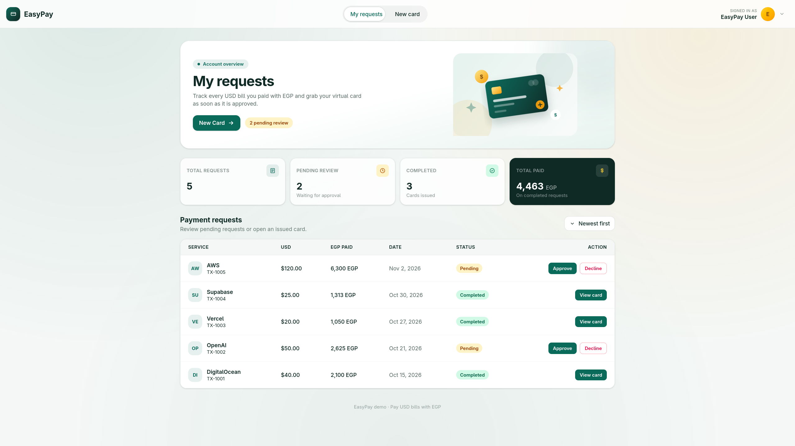
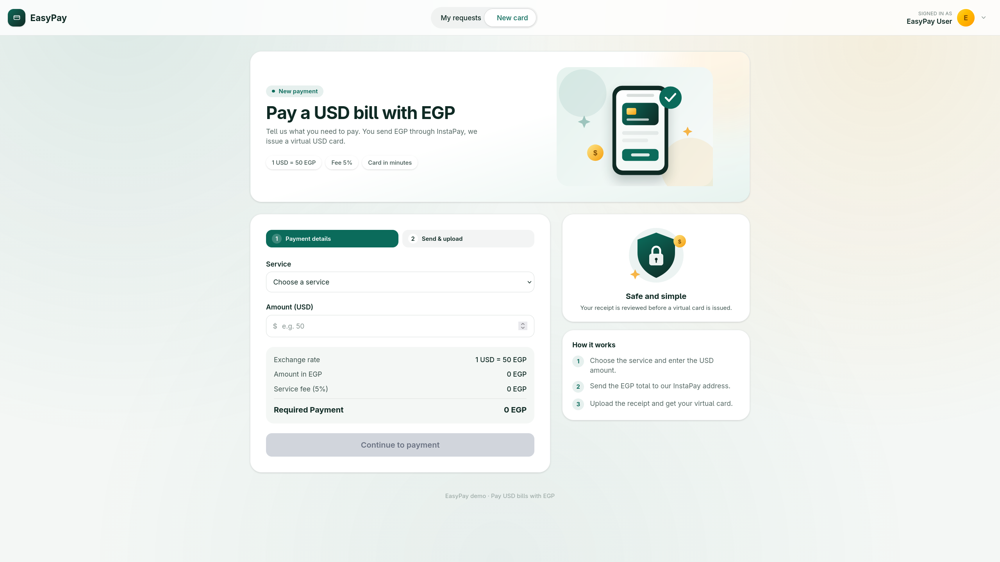
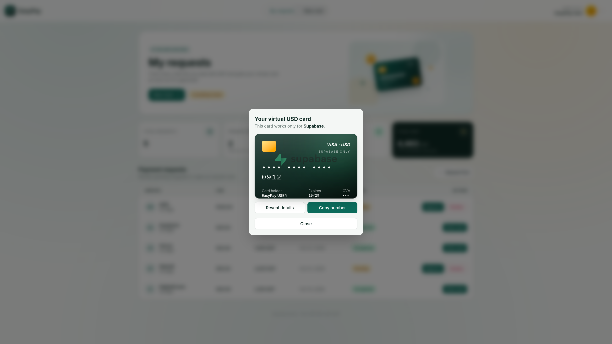
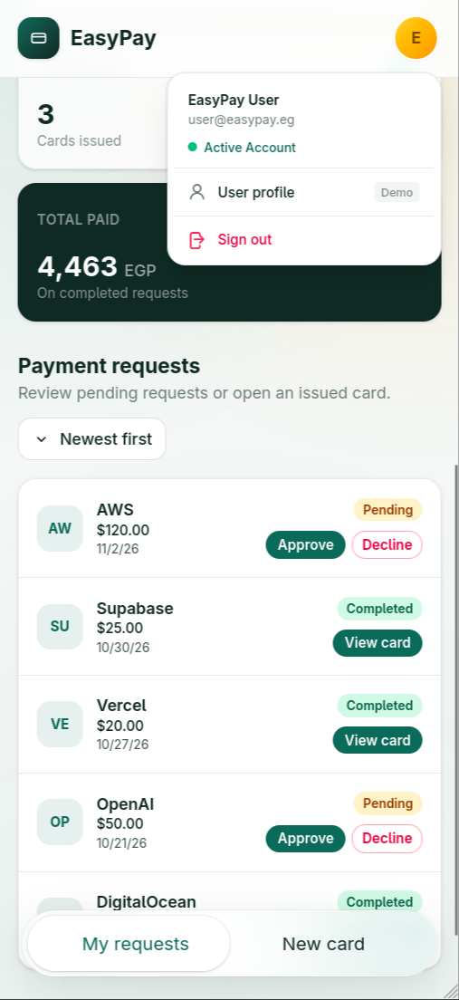

# 💳 EasyPay

> **Pay international USD bills and subscriptions using Egyptian Pounds (EGP) via InstaPay, backed by single-service Virtual Cards.**

[](https://angular.dev/)
[](https://tailwindcss.com/)
[](https://www.typescriptlang.org/)

---

## 📌 Overview

Developers and businesses in Egypt often face restrictions and currency friction when paying for critical cloud infrastructure and software subscriptions (such as AWS, OpenAI, Vercel, Supabase, Google Cloud, and DigitalOcean).

**EasyPay** provides a seamless, intuitive bridge:
1. **Calculate & Convert:** Enter your bill in USD and see a transparent conversion to EGP with live exchange rates and fees.
2. **Pay Locally:** Transfer EGP instantly using Egypt's local instant payment network (**InstaPay**) and upload your transfer receipt.
3. **Get Virtual Card:** Upon request approval, receive a dedicated, single-service **Virtual USD Card** with full credentials to settle your SaaS invoice securely.

---

## 📸 Screenshots & Previews


### 1. Dashboard & Account Overview
> *Monitor payment requests, total spend in EGP, approval states, and issued cards.*



---

### 2. Checkout & InstaPay Payment Flow
> *Transparent currency conversion breakdown, one-click InstaPay address copying, and receipt proof upload.*



---

### 3. Branded Virtual USD Card Modal
> *Customized card visual per cloud vendor (AWS, Supabase, Vercel, OpenAI, etc.) with number masking and copy features.*



---

### 4. User Profile Dropdown & Mobile Navigation
> *Polished header user dropdown and frosted glass bottom navigation bar.*



---

## ✨ Key Features

- **📊 Comprehensive Financial Dashboard:**
  - Real-time statistics: Total requests, pending reviews, completed orders, issued virtual cards, and total EGP spent.
  - Sort transactions by date (newest/oldest).
  - Built-in interactive demo actions: approve or decline requests with real-time reactive state updates.

- **💱 Smart Checkout & Conversion Engine:**
  - Support for popular cloud & AI services (AWS, Supabase, Vercel, DigitalOcean, OpenAI, Google Cloud).
  - Automatic quote calculation: Base conversion ($1 USD = 50 EGP) + transparent 5% platform fee.
  - Client-side validation: USD limits ($5 – $1,000), numerical paste protection, and receipt upload preview.

- **💳 Dynamic Virtual USD Cards:**
  - Service-locked cards: Each card is dedicated to a specific vendor for enhanced security.
  - Brand-specific theme gradients and official service logos.
  - One-tap show/hide card number masking (`•••• •••• •••• 1234`).
  - One-click clipboard copying with haptic/visual confirmation.
  - Accessible modal dialog with body scroll-lock and keyboard ESC dismissal.

- **👤 User Profile & Header Navigation:**
  - Animated top navigation pill with native View Transitions API.
  - User profile dropdown menu with demo profile actions and sign-out triggers.
  - Outside-click and escape-key auto-dismissal.

- **📱 Mobile-First Responsive Experience:**
  - Floating bottom navigation with frosted glassmorphism (`backdrop-blur`).
  - Full touch-friendly controls and responsive grid layouts.

- **🔔 Reactive Toast System:**
  - Signals-based notifications for approvals, declines, clipboard actions, and demo events.

---

## 🛠️ Tech Stack

| Category | Technology | Description |
| :--- | :--- | :--- |
| **Framework** | [Angular 22](https://angular.dev/) | Standalone components, modern Signals (`signal`, `computed`), `@if` / `@for` syntax |
| **Styling** | [Tailwind CSS v4](https://tailwindcss.com/) | Utility-first CSS, modern CSS `@theme`, glassmorphism, responsive utilities |
| **Languages** | [TypeScript](https://www.typescriptlang.org/) | Strict type-safety, reactive forms, and strong models |
| **Animation** | View Transitions API & CSS Keyframes | Fluid page transitions, toast fly-ins, and card pop effects |
| **Icons & Assets** | Scalable Vector Graphics (SVG) | Hand-crafted and brand vector icons |

---

## 📁 Project Structure

```text
EasyPay/
├── public/                     # Static assets & public files
│   ├── favicon.svg
│   ├── i18n/                   # Translation dictionaries (en.json)
│   └── images/                 # Hero illustrations & service SVG logos
│       └── services/           # (AWS, Supabase, Vercel, OpenAI, etc.)
├── src/
│   ├── app/
│   │   ├── components/
│   │   │   ├── checkout/       # Checkout & receipt submission form
│   │   │   ├── dashboard/      # Overview stats & requests data table
│   │   │   ├── shell/          # App shell, top header, user menu & bottom nav
│   │   │   └── virtual-card/   # Interactive virtual credit card component
│   │   ├── models/             # Transaction and VirtualCard TypeScript models
│   │   ├── services/
│   │   │   ├── language.service.ts     # Localization / translation service
│   │   │   ├── toast.service.ts        # Signals-based toast notification service
│   │   │   └── transaction.service.ts  # State management & business logic
│   │   ├── app.config.ts       # Application providers & router configuration
│   │   └── app.routes.ts       # Route declarations
│   ├── styles.css              # Global styles, Tailwind imports & keyframes
│   └── main.ts                 # Application bootstrap entry point
├── docs/                       # Project documentation & screenshots
│   └── images/                 # Image assets for README
├── angular.json                # Angular CLI configuration
└── package.json                # Project dependencies and scripts
```

---

## 🚀 Getting Started

### Prerequisites

Ensure you have the following installed on your machine:
- **Node.js** (v20.x or higher recommended)
- **npm** (v10.x or higher)
- **Angular CLI** (`npm i -g @angular/cli`)

### Installation

1. **Clone the repository:**
   ```bash
   git clone https://github.com/your-username/EasyPay.git
   cd EasyPay
   ```

2. **Install project dependencies:**
   ```bash
   npm install
   ```

3. **Start the local development server:**
   ```bash
   npm start
   # or
   ng serve
   ```

4. **Open your browser:**
   Navigate to [http://localhost:4200/](http://localhost:4200/).

---


To create a production build:

```bash
npm run build
```
The optimized production bundle will be output to the `dist/EasyPay/` directory.

---

## 💡 How to Test the Demo Flow

1. **Browse Requests:** Start at the **Dashboard** (`/dashboard`). Review existing payment requests and key account metrics.
2. **Approve a Payment:** Click **Approve** on any pending request. An animated virtual USD card will be generated and displayed in a modal.
3. **Inspect the Virtual Card:**
   - Click the eye icon to unmask the card number.
   - Click the copy button to copy the card number to your clipboard.
4. **Create a New Payment:**
   - Click **New payment** (`/checkout`).
   - Select a service (e.g. *OpenAI* or *AWS*).
   - Enter an amount in USD (e.g., `$50`). Notice the live conversion to EGP and transparent fee breakdown.
   - Click **Continue to payment**.
   - Copy the demo InstaPay address (`EasyPay@instapay`).
   - Upload any image receipt (PNG/JPG) and click **Submit request**.
5. **View Newly Created Request:** You will be redirected back to the dashboard where your new request appears in `Pending` state ready for review!

---

## ⚙️ Configuration

Default demo rates and services are configured in [`src/app/services/transaction.service.ts`](file:///home/rapkt/Projects/EasyPay/src/app/services/transaction.service.ts):

```typescript
readonly rate = 50;              // 1 USD = 50 EGP
readonly feePercent = 5;         // 5% service fee
readonly instapayAddress = 'EasyPay@instapay';
readonly services = ['AWS', 'Supabase', 'Vercel', 'DigitalOcean', 'OpenAI', 'Google Cloud'];
```
